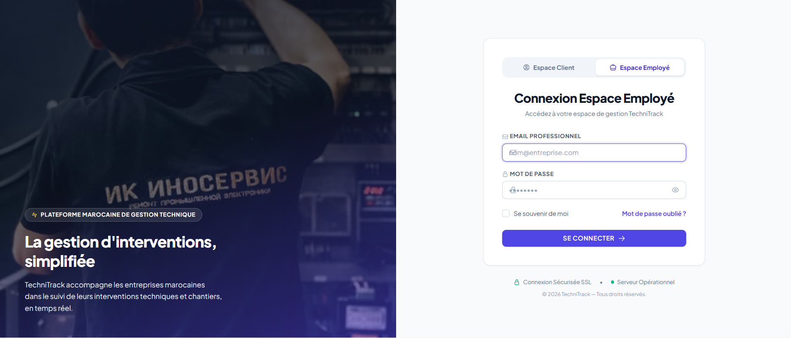
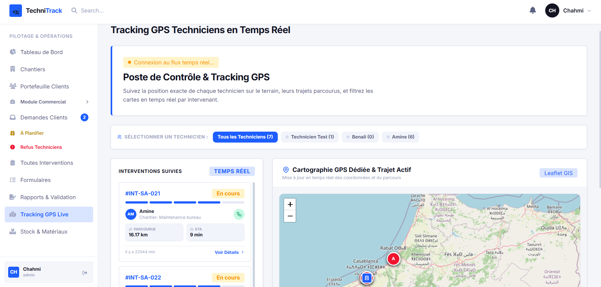
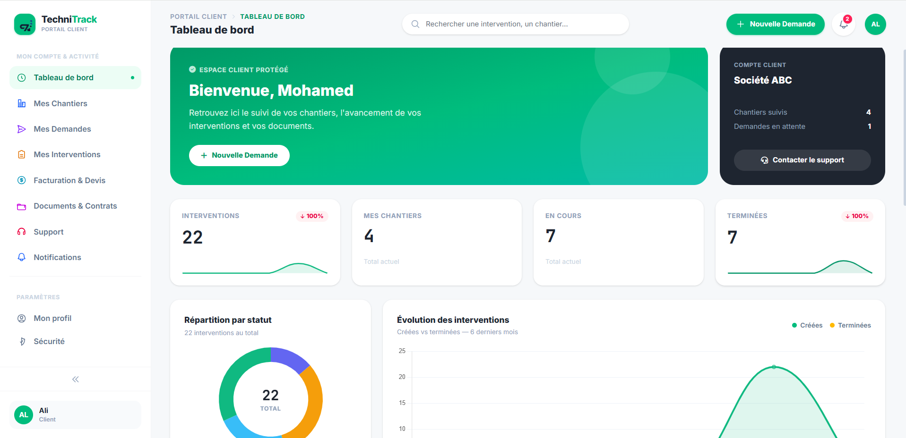
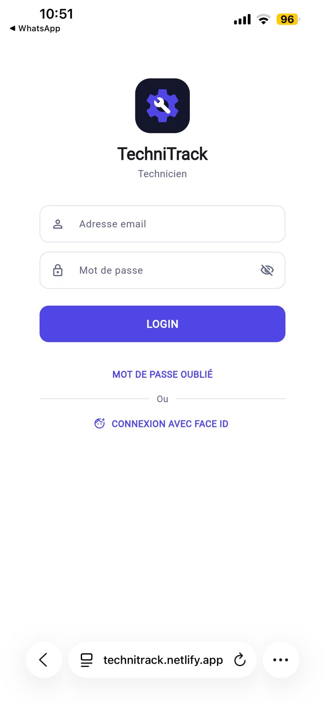
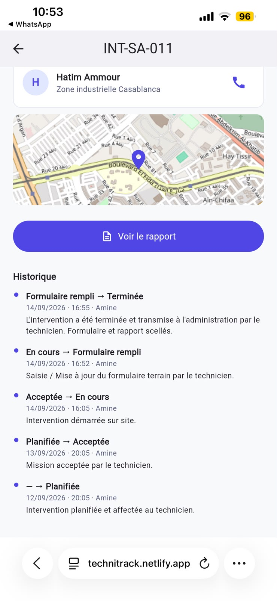

<h1 align="center">TechniTrack</h1>

<p align="center">
  <strong>Plateforme web et mobile de gestion des interventions techniques</strong><br>
  De la demande client jusqu’à la validation du rapport, en temps réel.
</p>

<p align="center">
  
  
  
  
  
</p>

<p align="center">
  
</p>

---

## 📌 Présentation

Dans beaucoup d’entreprises, le suivi des interventions techniques se fait encore par téléphone, e-mail ou fichiers Excel : les informations sont dispersées et il est difficile de savoir où en est chaque chantier.

**TechniTrack** centralise tout ce cycle dans une seule plateforme :

1. le **client** envoie une demande depuis son espace ;
2. l’**administration** planifie l’intervention et l’affecte à un technicien ;
3. le **technicien** la reçoit sur mobile, se rend sur site, remplit le formulaire et le rapport ;
4. l’intervention est **validée**, et le client suit chaque étape en temps réel.

## ✨ Fonctionnalités principales

| Module | Description |
| --- | --- |
| 🏗️ **Clients & chantiers** | Centralisation des clients, de leurs chantiers et de leurs emplacements. |
| 🛠️ **Interventions** | Planification, affectation et suivi des statuts (planifiée → acceptée → en cours → terminée). |
| 📍 **Tracking GPS en temps réel** | Position des techniciens sur carte, trajet parcouru et temps d’arrivée estimé. |
| 📝 **Formulaires & rapports** | Formulaires terrain, rapports d’intervention et validation par l’administration. |
| 📦 **Stock & matériel** | Suivi du matériel utilisé lors des interventions. |
| 💼 **Module commercial** | Demandes clients, devis et facturation. |
| 🔔 **Notifications temps réel** | Alertes instantanées à chaque changement important. |
| 📱 **Application technicien** | Interface mobile reliée au backend via une API REST sécurisée. |

## 👥 Profils utilisateurs

Chaque profil dispose d’un espace adapté à ses responsabilités :

| Profil | Rôle principal |
| --- | --- |
| **Super administrateur** | Administration générale de la plateforme |
| **Administrateur** | Pilotage des opérations, planification et validation |
| **Commercial** | Suivi des demandes clients, devis et interventions |
| **Technicien** | Exécution des interventions sur le terrain (mobile) |
| **Client** | Suivi de ses chantiers, demandes et documents |

## 🖥️ Aperçu de l’application

### Poste de contrôle — Tracking GPS des techniciens

<p align="center">
  
</p>

### Portail client — Tableau de bord

<p align="center">
  
</p>

### Application mobile — Technicien

<p align="center">
  
  &nbsp;&nbsp;&nbsp;
  
</p>

## 🛠️ Technologies utilisées

| Technologie | Utilisation |
| --- | --- |
| **PHP 8.2 / Laravel 12** | Backend et logique métier |
| **MySQL** | Base de données |
| **Blade, Tailwind CSS, Alpine.js** | Interfaces web |
| **Laravel Sanctum** | Authentification de l’API mobile |
| **Spatie Laravel Permission** | Gestion des rôles et permissions |
| **Laravel Reverb / Echo** | Temps réel (notifications, suivi GPS) |
| **Leaflet** | Cartographie et géolocalisation |
| **DomPDF** | Génération de documents PDF |

**Architecture :** `Controller → Service → Model` — la logique métier est regroupée dans des services, les contrôleurs restent légers.

## 🚀 Installation

### Prérequis

- PHP 8.2+
- Composer
- Node.js et npm
- MySQL

### Étapes

```bash
# 1. Cloner le projet
git clone https://github.com/ikramcharqy/Intervention.git
cd Intervention

# 2. Installer les dépendances
composer install
npm install

# 3. Configurer l’environnement
cp .env.example .env          # Windows PowerShell : Copy-Item .env.example .env
php artisan key:generate

# 4. Configurer la base de données dans .env, puis :
php artisan migrate
```

### Lancer l’application

```bash
php artisan serve      # terminal 1 : serveur Laravel
npm run dev            # terminal 2 : assets front-end
php artisan reverb:start   # terminal 3 (optionnel) : temps réel
```

L’application est accessible sur **http://127.0.0.1:8000**.

## 📁 Structure du projet

```text
Intervention/
├── app/
│   ├── Http/Controllers/   # Contrôleurs (web et API)
│   ├── Services/           # Logique métier
│   └── Models/             # Modèles Eloquent
├── routes/
│   ├── web.php             # Routes web
│   └── api.php             # Routes de l’API mobile
├── resources/views/        # Interfaces Blade
├── database/migrations/    # Structure de la base de données
├── docs/screenshots/       # Captures d’écran
└── tests/                  # Tests automatisés
```

## 🎯 Objectif

Proposer une solution **centralisée, claire et évolutive** pour mieux organiser les interventions techniques et faciliter la collaboration entre clients, équipes administratives et techniciens sur le terrain.

## 👩‍💻 Auteur

**Ikram Ech-charqy**
Étudiante ingénieure en Génie Informatique — ENSAM Meknès

[](https://github.com/ikramcharqy)

---

<p align="center"><em>Projet de développement logiciel réalisé avec Laravel.</em></p>
